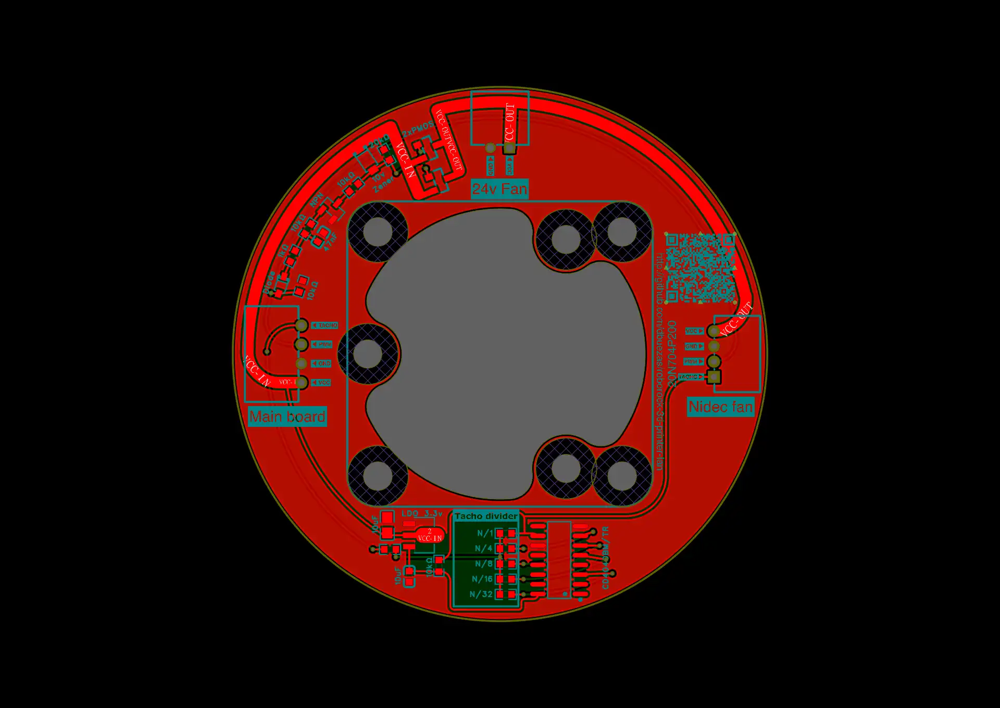
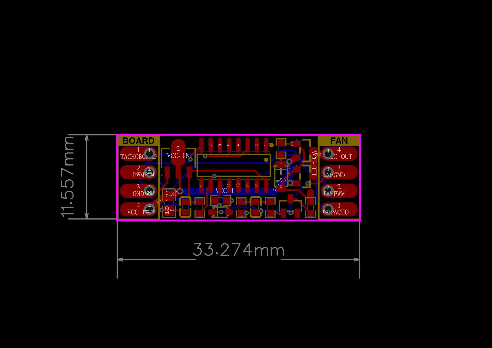
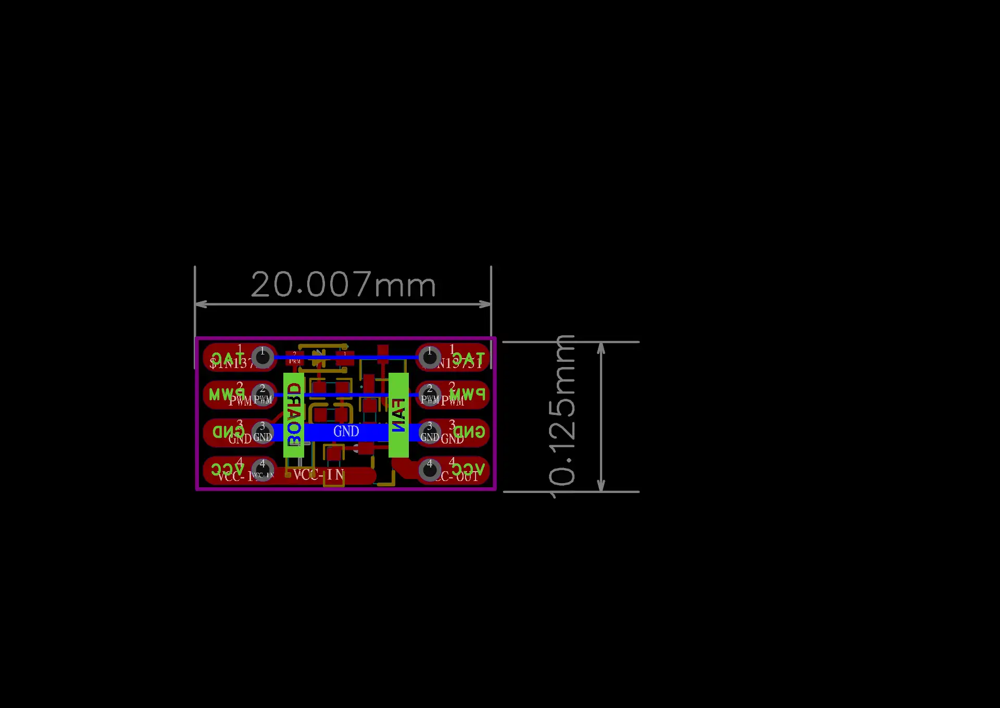

# Roborock fan driver with tacho frequency divider

A small board that goes between a 3D printer mainboard and a Roborock vacuum fan, so the fan can be driven by the printer like a normal PWM fan.

The problem: when the fan's PWM signal goes to 0, the motor controller enters standby and stays there, even after PWM comes back. This board switches the fan's VCC on only while PWM is above 0, so the fan is fully powered down when not in use and wakes up normally the next time.

There are three variants:

| Disk shape                                | Compact rectangular                                         | Super compact                                   |
| ----------------------------------------- | ----------------------------------------------------------- | ----------------------------------------------- |
|  |  |  |
| 2 P-MOSFETs in parallel                   | 2 P-MOSFETs in parallel                                     | 1 P-MOSFET                                      |
| Tacho divider, selectable N/1 to N/32     | Tacho divider, fixed N/32                                   | No tacho divider                                |
| Connectors + extra fan header             | Solder pads                                                 | Solder pads                                     |

## Status and notes

- I use the **disk shape** board, on 24 V with Marlin. It has been running for about a year without issues.
- The **compact rectangular** and **super compact** boards are untested. The super compact one has a single P-MOSFET. I think that's fine, but I haven't tried it.
- The fan is ridiculously powerful. I almost never run it above 10 %.
- **Tacho divider:** I used it once and never again, so it's probably not worth it. It's probably only useful with Marlin.
- **"24v Fan" header (disk shape only):** for a small extra fan that cools the vacuum fan's controller. It's probably unnecessary unless you run the vacuum fan near 100 %. As drawn, it's on VCC-OUT, so it runs at full speed whenever the vacuum fan is on. Driving it through another MOSFET from the PWM signal, so its speed follows the PWM, would be better.

## How it works

D2, R3 and C3 form a peak detector on the PWM line. Each PWM pulse charges C3 through the Schottky diode D2 and R3 (1 kΩ). D2 stops C3 from discharging back into the PWM line, so the only way out is through R1 (10 kΩ) into the base of the NPN transistor Q2. While C3 is charged, Q2 pulls the gate of the P-MOSFET(s) low and VCC is switched through to the fan. When PWM stays at 0, C3 empties, Q2 turns off, R13 pulls the gate back up to VCC-IN and the fan loses power. The 10 V zener D1 keeps the MOSFET gate-source voltage within its limit at 24 V.

## PWM frequency

C3 is small (47 nF), so the hold time between PWM pulses is short. A rough simulation (not measured) puts it at a few milliseconds, so the PWM frequency matters:

- **~25 kHz**: works perfectly every time (my setup, with Marlin). In Klipper that's `cycle_time: 0.00004`.
- **Low frequencies** (e.g. Klipper's default 100 Hz): C3 can empty between pulses, so VCC may get chopped or never fully turn on. I haven't tested this.

If you run the fan at a low PWM frequency, take a look at R1 and C3. For example, C3 = 1 µF plus 100 kΩ from the base of Q2 to GND should keep VCC on for roughly 30 ms after the last pulse (again only simulated).

## Files

- `roborock-fan-driver.epro2`: the EasyEDA Pro project with all three boards (schematics, PCBs, footprints and LCSC part numbers). Open it in [EasyEDA Pro](https://easyeda.com/page/download) or the [web editor](https://pro.easyeda.com/editor) with **File → Open → EasyEDA Pro…**
- `export/<board>/`: files exported from EasyEDA Pro for each board.
- `export/altium.zip`: Altium Designer export of all three boards. KiCad can import the `.schdoc` and `.pcbdoc` files through **File → Import**. The conversion may not be perfect, so use the Gerbers for manufacturing.

| Board               | Schematic                                                 | Gerber                                              | BOM                                           | Pick and place                                                      |
| ------------------- | --------------------------------------------------------- | --------------------------------------------------- | --------------------------------------------- | ------------------------------------------------------------------- |
| Disk shape          | [schematic.pdf](export/disk-shape/schematic.pdf)          | [gerber.zip](export/disk-shape/gerber.zip)          | [bom.csv](export/disk-shape/bom.csv)          | [pick-and-place.csv](export/disk-shape/pick-and-place.csv)          |
| Compact rectangular | [schematic.pdf](export/compact-rectangular/schematic.pdf) | [gerber.zip](export/compact-rectangular/gerber.zip) | [bom.csv](export/compact-rectangular/bom.csv) | [pick-and-place.csv](export/compact-rectangular/pick-and-place.csv) |
| Super compact       | [schematic.pdf](export/super-compact/schematic.pdf)       | [gerber.zip](export/super-compact/gerber.zip)       | [bom.csv](export/super-compact/bom.csv)       | [pick-and-place.csv](export/super-compact/pick-and-place.csv)       |

To order a board, upload its `gerber.zip` to JLCPCB (or any other PCB fab). For JLCPCB assembly, also upload `bom.csv` and `pick-and-place.csv`.
